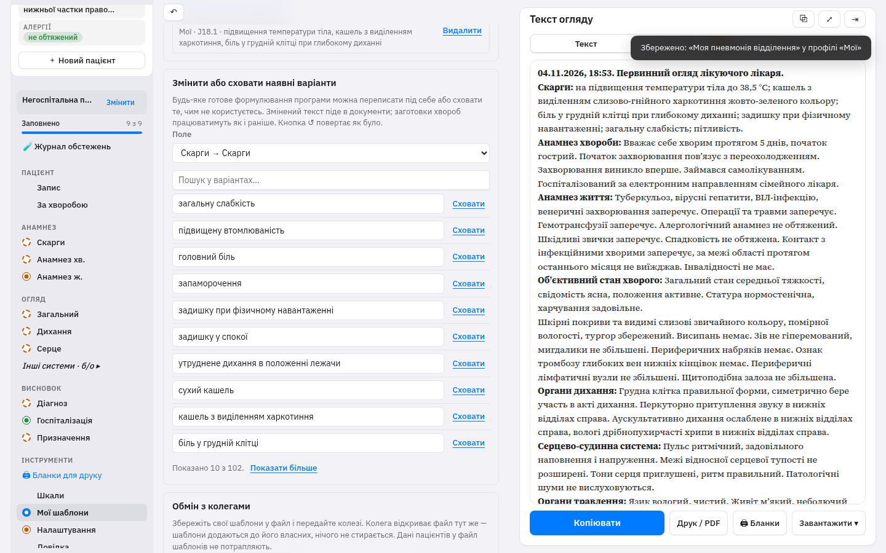
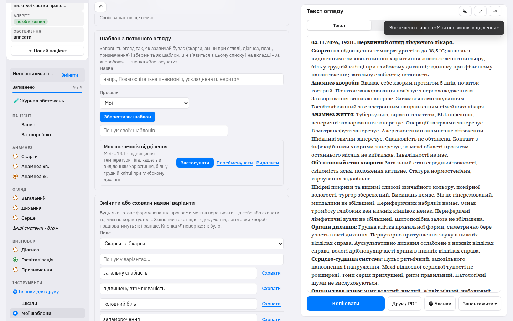
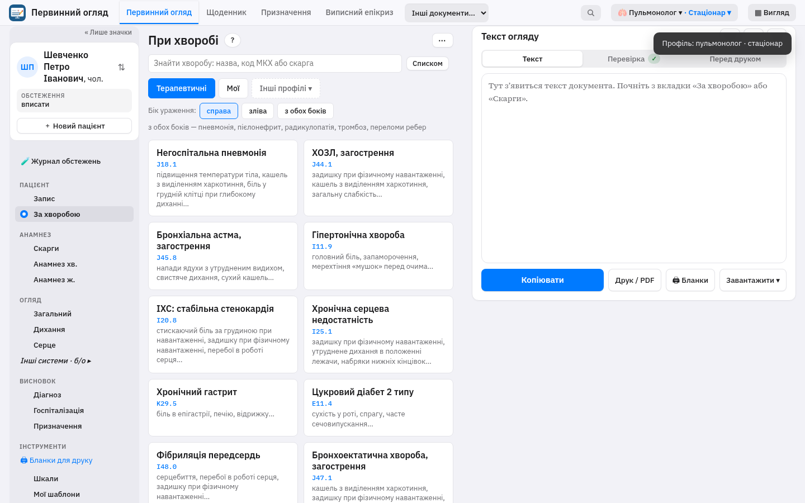
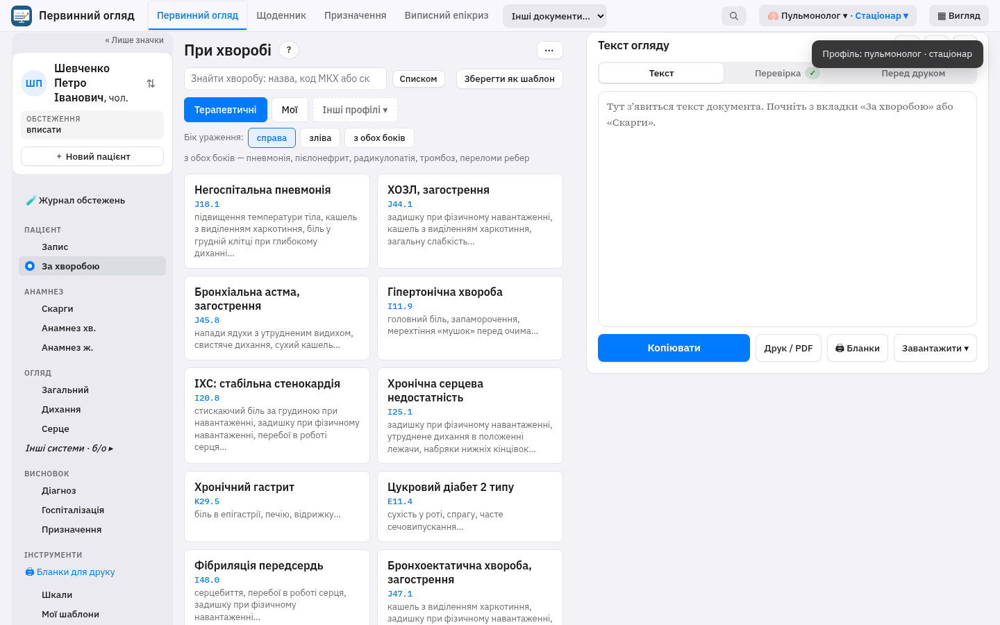
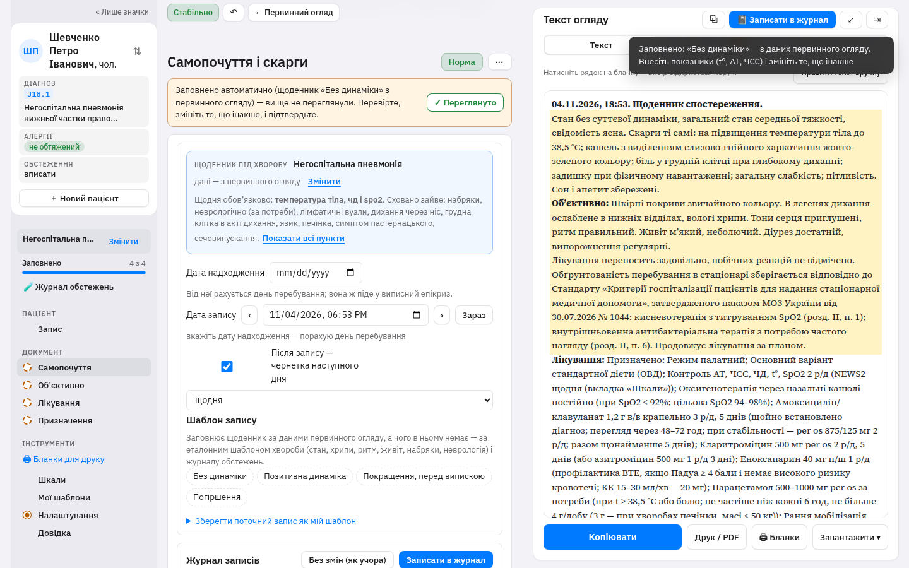
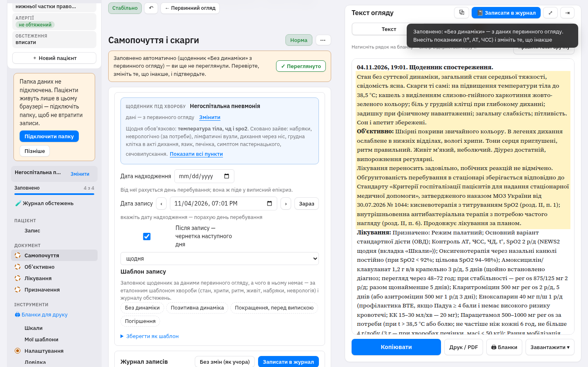
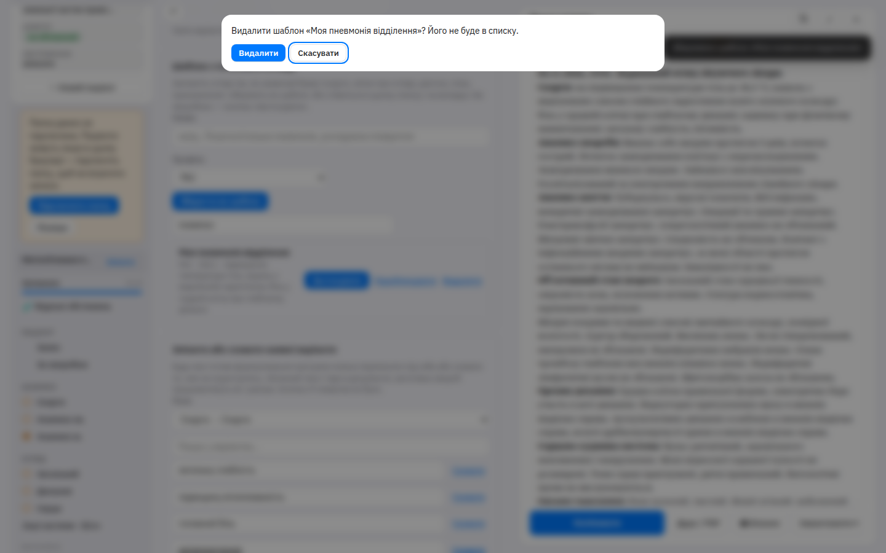
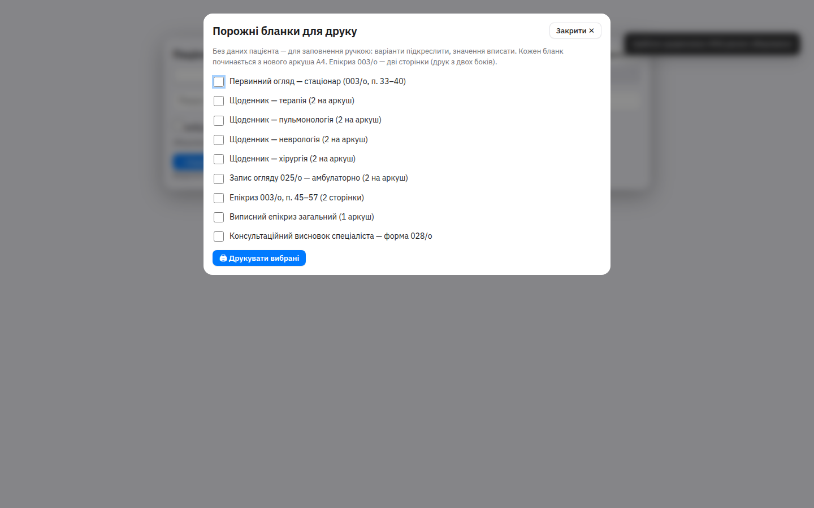

# Аудит шаблонів і сусідніх дій лікаря

Версія на старті аудиту: **0.9.3.86**. Після правок цього PR: **0.9.3.87**.

Прохід зроблено в headless Chrome як лікар-пульмонолог стаціонару: знайомство, профіль «Пульмонолог · стаціонар», пацієнт, заготовка «Негоспітальна пневмонія», «Мої шаблони» (створити, знайти, застосувати, перейменувати, видалити), імпорт чужого JSON і зіпсованого файлу, щоденник і «Як учора», порожні бланки, пошук Ctrl+K, налаштування, теми. Офлайн-файл `pervynnyi-ohliad.html` відкривається без мережі; service worker і маніфест підключені на `index.html` (сайт), не в офлайн-файлі — так і задумано.

Знімки: `artifacts/screenshots/`.

## Знімки

| | Було | Стало |
|---|---|---|
| Список своїх шаблонів |  |  |
| Хвороби профілю |  |  |
| Щоденник |  |  |

Підтвердження видалення: .

Порожні бланки (без змін змісту, один крок «Друкувати вибрані»): .

## Знайдені помилки

### Виправлено

1. **Видалений свій варіант не можна було додати знову.** `removeOptionLive` прибирав пункт зі списку на екрані, але лишав текст у даних поля. Повторне «Додати» відповідало «Такий варіант уже є», хоча в «Своїх варіантах» рядка вже не було. Якщо варіант був вибраний у полі, «Видалити» його взагалі не чіпало.
   - Відтворення: «Мої шаблони» → поле «Загальний стан» → текст «Свій варіант для аудиту» → «Додати» → «Видалити» → той самий текст → «Додати».
   - Тепер варіант ховається, не зсуваючи номери решти пунктів у цій сесії, і те саме формулювання додається знову. Вибраний пункт при видаленні скидається.
2. **У текст потрапляло порожнє «…».** Поле, у якому лише символ «…» (так щоденник «Погіршення» заповнює «Корекцію лікування»), друкувалось як фраза. Тепер таке поле вважається порожнім: у документ не йде, а якщо для поля є підстановка («з журналу», «з огляду») — працює вона.
3. **Незаповнений бакпосів і дата перегляду антибіотика друкувались як «…».** У обґрунтуванні за наказом № 1328 завжди були клаузи «бактеріологічне дослідження до початку — …» і «перегляд ефективності — …», навіть коли лікар їх не вносив. Перевірка перед підписом про бакпосів лишається. У текст клауза потрапляє лише з реальним значенням.
4. **Шаблон не зберігався з самого лише огляду.** Кнопка вимагала скарги або діагноз і відмовляла, якщо заповнені тільки зміни в системах. Тепер досить скарг, огляду, діагнозу, плану або призначень. Порожні рядки листа призначень у шаблон не пишуться.

### Не виправлено, і чому

1. **Після перезапуску номери своїх варіантів усе ще можуть зсунутись**, якщо видалити не останній свій пункт, а в картці пацієнта збережений номер пункту, а не текст. У поточній сесії номери стабільні. Переписати збереження полів на текст — окрема зміна для всіх карток пацієнтів, її не змішували з цим PR.
2. **Клік по фразі в тексті («бачу-редагую»)** не чіпався: це паралельна робота іншого запуску.
3. **Порожні бланки для ручки** навмисно лишають лінії і варіанти «підкреслити». Це не помилка друку порожнього клінічного твердження. У тексті щоденника і на бланку 003/о незаповнені «нормальні» фрази («оформлене», «свідомість не порушена») вже прибрані попередніми версіями; повторна перевірка це підтвердила.

## Що перевірено і працює

- Заготовки за профілем: після «Пульмонолог · стаціонар» першими стоять негоспітальна пневмонія, ХОЗЛ, астма, бронхоектатична хвороба.
- Застосування заготовки заповнює скарги, анамнез, огляд, діагноз з МКХ, план і схему. Якщо лікар уже щось вписав, спершу вікно «Що взяти з шаблону»; головна кнопка тепер «Застосувати».
- Плейсхолдер статі `[хворий|хвора]`: при вибраній статі підставляється одна форма, без статі лишається «чоловіча/жіноча» і перевірка про це попереджає.
- Імпорт: зіпсований файл відхиляється; файл `po-templates` додає варіанти й хвороби, не стираючи свої; невідомий профіль стає «Мої». Експорт лишає пацієнтів за межами файлу.
- «Без змін (як учора)»: без журналу — зрозуміле повідомлення, нічого не копіює. Після запису копіює опис (позначка «з учора», у прогоні 11 полів) і очищає температуру, АТ, ЧСС, ЧД, SpO2. «Порівняти з учора» без попереднього запису пояснює, що порівнювати ні з чим.
- Порожні бланки: 9 форм, одна кнопка «Друкувати вибрані», кожен бланк з нового аркуша.
- Пошук Ctrl+K знаходить «Мої шаблони». Теми (включно з «Теплий папір») перемикаються. Розділи документа, налаштування і знайомство відкриваються без помилок у консолі.

## Болі інтерфейсу (частину знято в цьому PR)

Знято тут, без зміни загальної розкладки:

- У списку свого шаблону була лише «Видалити», застосувати можна було тільки карткою на «За хворобою». Тепер у рядку одна синя **«Застосувати»** (якщо вже стоїть — статус «Застосовано»), плюс «Перейменувати».
- Списку своїх шаблонів не було пошуку (пошук був лише в чужих формулюваннях). Додано поле над списком.
- «Зберегти як мою хворобу» не збігалося з рештою «шаблон» і ховалося на вкладці інструментів. Кнопка називається **«Зберегти як шаблон»** і є в меню «⋯» розділу та біля пошуку хвороб. У щоденнику спойлер теж називається «Зберегти як шаблон».
- Видалення свого варіанта було миттєвим, шаблону — другим кліком «Точно?» на 3 секунди. Тепер вікно з «Видалити» і «Скасувати»; заміна шаблону з тією самою назвою теж питає.
- Порожні «…» більше не йдуть у текст, який копіюють у МІС.

Лишилось (навмисно не в цьому PR — це вже розкладка):

- На кожному розділі одночасно «За шаблоном», «Норма», «⋯» з друком і очищенням. Кнопок багато, головна дія документа («Копіювати») при цьому одна і на місці.
- Два вікна на старті: «Вітаю» і одразу «Налаштуймо програму».
- Картки хвороб самі є кнопкою, підпису «Застосувати» на них немає. Підпис стоїть у списку своїх шаблонів, де раніше дії не було видно.
- «Без змін (як учора)» стоїть біля журналу, а не як єдина дія щоденника. Після «Записати в журнал» програма сама готує чернетку наступного дня; це легко не помітити в тості.

## Пропозиції далі, за пріоритетом

Оцінка — обсяг змін, не календар.

1. **Старт зі списку пацієнтів і одна головна дія на пацієнта.** Окремий PR розкладки. Список уже є. На рядку лишити одну кнопку: якщо сьогодні немає щоденника — «Щоденник», якщо огляд порожній — «Огляд», інакше — «Продовжити». Решта (файли, перенесення, бланки) — під «⋯», як уже зроблено для перенесення. Обсяг: екран списку і шапка пацієнта, без зміни тексту документів.
2. **Щоденник: одне поле опису і «Як учора».** Зараз «Самопочуття», «Об’єктивно» і «Лікування» — багато списків, а лікар у відділенні править два-три речення і цифри. Залишити рядок показників (t, АТ, ЧСС, ЧД, SpO2) і одне поле «Запис»; «Як учора» копіює вчорашній текст і очищає цифри, як уже вміє. Решту пунктів бланка 003/о сховати під «Усі пункти». Обсяг: секції щоденника, бланк 003/о і профіль пунктів; медичні фрази не вигадувати наново, лише зібрати вже наявні.
3. **Один рядок дій документа.** Прибрати дублі «За шаблоном» / «Друк» / «Очистити» з кожного розділу. Лишити їх один раз над формою: «За шаблоном» (якщо шаблон обрано), «Норма», «⋯». Обсяг: `617-ergo.js` і стилі Apple, окремо від пункту 1, щоб не змішувати два макети.
4. **Зберігати вибраний пункт текстом, не номером.** Тоді видалення свого варіанта не зможе підмінити сусідній пункт у старій картці після перезапуску. Потрібне читання старих карток і міграція. Окремий PR, з тестом «зберегти → перезапустити».
5. **Одне знайомство замість двох вікон.** ПІБ лікаря, спеціальність і відділення в одному кроці. Малий обсяг: з’єднати вже наявні вікна вітання і профілю.
6. **Порожній бланк щоденника за профілем.** Для пульмонолога в «Бланках» одразу позначений пульмонологічний щоденник, решта — ні. Малий обсяг, лише початкова галочка.
7. **Іменовані вставки в шаблоні** (`{день}`, `{антибіотик}`) поряд із уже робочим `[хворий|хвора]`. Середній обсяг: формат шаблону і підстановка в момент «Застосувати», без нових медичних текстів.

Пункти 1–2 — це якраз запланований наступний макет. Цей PR їх не починає: лишає поточні екрани і робить шаблони однозначними.
